## Priority setting in health

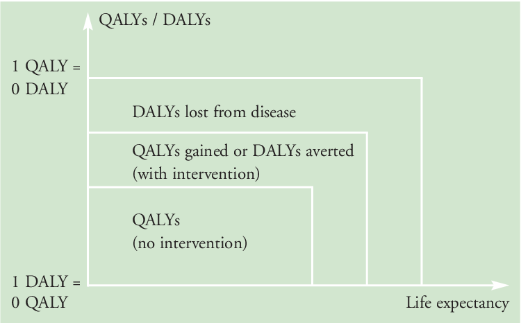{.r-stretch fig-align="center"}

::: {.source style="text-align: center;"}
Fox-Rushby, Julia. "Disability-adjusted life years (DALYs) for decision-making?: an overview of the literature." (2002).
:::

## Priority setting in Denmark

:::: columns
::: {.column width="55%"}
-   Historically: region-level prioritization based on general principles
-   Danish Medicines Council: principled recommendations of coverage for pharmaceutical treatment
    -   2021: incorporation QALYs into assessment
-   2024: National Priority Council
    -   Broader scope than DMC
    -   Address demographic transition, labor constraints, regional and municipal variation
:::

::: {.column width="45%"}
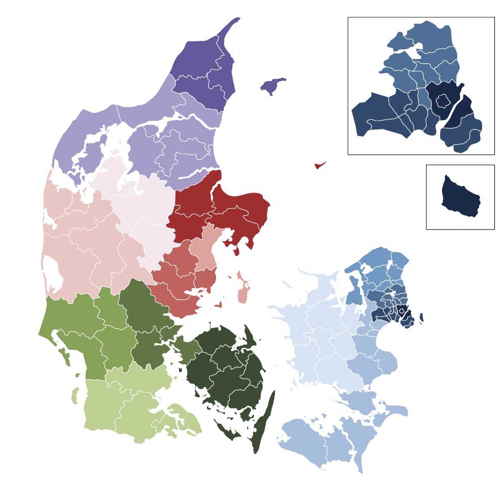{height="520"}
:::
::::

::: notes
Danish Health Act: equal access to mental/physical care, universal coverage
:::

## Gap: non-health consequences of disease

:::: columns
::: {.column width="45%"}
-   Economic, social, psychological, consequences of disease not captured in DALY/QALY
-   Hypotheses:
    -   These impacts are substantial, even in Denmark
    -   These may not correlate to morbidity/mortality patterns by disease
:::

::: {.column width="55%"}
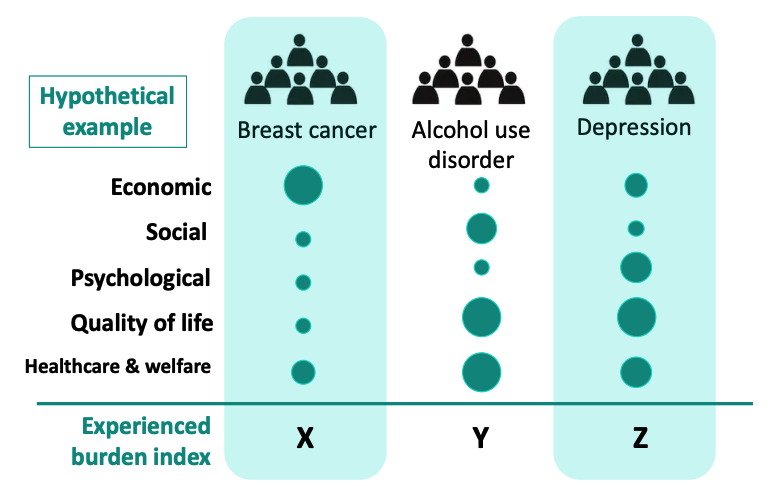
:::
::::

## Experienced burden of disease in Denmark

-   We aim to estimate longitudinal economic and social impacts of hospital-diagnosed mental and physical disease across the Danish population from an individual perspective.
    -   Comprehensive: population-level, inclusive
    -   Long-term: 10 year follow-up, 27 years of data
    -   Comparative: across and within diseases
    -   Rigorous but not causal
        -   Measurement bias for exposure
        -   Confounding

## Identification

:::: columns
::: {.column width="50%"}
::: col-head
Exposure
:::

-   1^st^ hospital diagnosis of disease (inpatient, outpatient, psychiatric)
-   Mental dx:
    -   Depression, alcohol use disorder (AUD), [eating disorders, bipolar disorder]{.c-green}
-   Somatic dx:
    -   Breast cancer, [stroke]{.c-red}, [spinal disc disorders, epilepsy, type 1 diabetes, inflammatory bowel disease (IBD)]{.c-green}
:::

::: {.column width="50%"}
::: col-head
Outcomes
:::

-   Part 1: [personal disposable income]{.c-red}
-   Part 2:
    -   [Biological/adoptive parenthood]{.c-green}
    -   [Household composition (children living in home)]{.c-green}
-   Part 3:
    -   [Total net wealth, all sources]{.c-orange}
    -   [Total savings and liquid assets]{.c-orange}
    -   [Property ownership (binary)]{.c-orange}
    -   [Relationship formation & dissolution]{.c-orange}
:::
::::

::: {style="text-align: center; font-size: 0.6em; margin-top: 0.6em;"}
[Red: 1^st^ paper, income loss]{.c-red}    [Green: 2^nd^ paper, parenthood]{.c-green}    [Orange: planned future work]{.c-orange}
:::

## Study design & methods

:::: columns
::: {.column width="64%"}
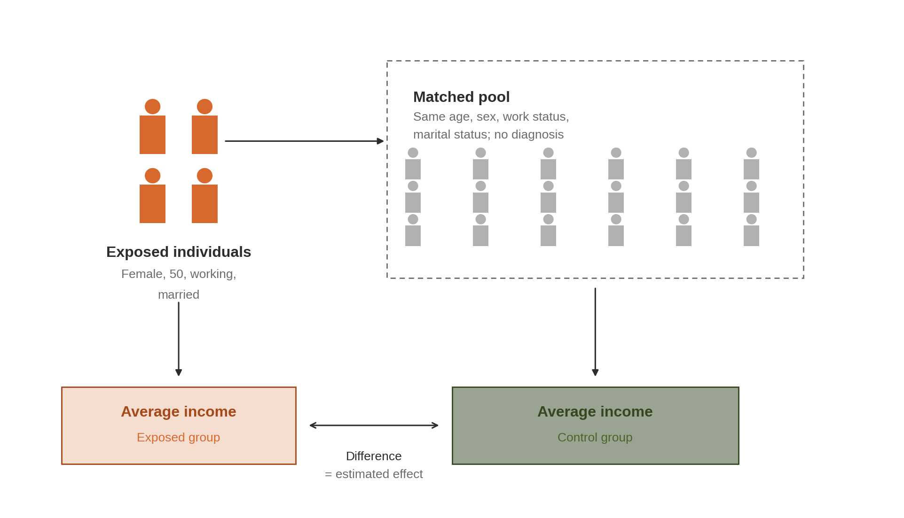
:::

::: {.column width="36%"}
::: label
Matching variables:
:::

::: card
::: card-head
Demographics
:::

-   Age, sex
-   Marital status
-   Household size
:::

::: card
::: card-head
Socio-economics
:::

-   Baseline income quantile
-   Educational attainment
-   Labor market attachment
:::

::: card
::: card-head
Baseline health
:::

-   Hospital contacts
-   Charlson comorbidities
:::
:::
::::

## Study design & methods

```{=html}
<svg viewBox="800 1050 10600 5600" width="100%" height="530" font-family="Arial, Helvetica, sans-serif" font-size="178">
  <defs>
    <marker id="l6-arrow" viewBox="0 0 10 10" refX="8" refY="5" markerWidth="4" markerHeight="4" orient="auto">
      <path d="M0,0 L10,5 L0,10 z" fill="#1a1a1a"/>
    </marker>
    <marker id="l6-dot" viewBox="0 0 10 10" refX="5" refY="5" markerWidth="3" markerHeight="3">
      <circle cx="5" cy="5" r="5" fill="#1a1a1a"/>
    </marker>
  </defs>

  <!-- Date of diagnosis / year 0 -->
  <text x="5985" y="1340" text-anchor="middle">Date of dx</text>
  <text x="5985" y="1553" text-anchor="middle">Year 0</text>
  <rect x="5989" y="1613" width="107" height="671" fill="#862633"/>
  <rect x="5990" y="2284" width="107" height="3835" fill="#C8C8C8"/>

  <!-- Match year line -->
  <rect x="4884" y="1688" width="107" height="4431" fill="#1a1a1a"/>

  <!-- Inclusion assessment window -->
  <text x="4800" y="2056" text-anchor="end" font-weight="700">Inclusion Assessment Window</text>
  <text x="4800" y="2269" text-anchor="end">Age 18+ , at least 1 year of follow-up</text>

  <!-- Washout -->
  <rect x="3256" y="2414" width="2733" height="523" rx="40" fill="#E07E3C"/>
  <text x="5898" y="2630" text-anchor="end" fill="#ffffff">Washout for exposure</text>
  <text x="5898" y="2843" text-anchor="end" fill="#ffffff">Years [-5, 0)</text>

  <!-- Education, SES, baseline income -->
  <text x="4188" y="3219" text-anchor="end">Education, SES, baseline income</text>
  <text x="4188" y="3432" text-anchor="end">Years [-3, -2)</text>
  <rect x="4280" y="3027" width="604" height="523" rx="40" fill="#E07E3C"/>

  <!-- Healthcare utilization -->
  <text x="3720" y="3848" text-anchor="end">Healthcare utilization</text>
  <text x="3720" y="4061" text-anchor="end">Years [-5, -3)</text>
  <rect x="3811" y="3661" width="1073" height="523" rx="40" fill="#E07E3C"/>

  <!-- Charlson comorbidity index -->
  <rect x="1689" y="4272" width="3195" height="523" rx="40" fill="#E07E3C"/>
  <text x="4792" y="4488" text-anchor="end" fill="#ffffff">Charlson Comorbidity Index</text>
  <text x="4792" y="4701" text-anchor="end" fill="#ffffff">Years [-8,-3)</text>

  <!-- Follow-up -->
  <rect x="6097" y="4889" width="4806" height="523" rx="40" fill="#789D4A"/>
  <text x="10812" y="5105" text-anchor="end" fill="#ffffff">Follow-up</text>
  <text x="10812" y="5318" text-anchor="end" fill="#ffffff">Years [0, 10 years or censor<tspan baseline-shift="super" font-size="120">1</tspan>)</text>

  <!-- Time axis -->
  <line x1="904" y1="5705" x2="11065" y2="5705" stroke="#1a1a1a" stroke-width="38" marker-start="url(#l6-dot)" marker-end="url(#l6-arrow)"/>
  <text x="4937" y="6349" text-anchor="middle" font-size="152">Match year</text>
  <text x="4937" y="6533" text-anchor="middle" font-size="152">(-1)</text>
  <text x="6043" y="6349" text-anchor="middle" font-size="152">Year 0</text>

  <!-- Footnote -->
  <text x="7092" y="6027"><tspan baseline-shift="super" font-size="120">1</tspan> Censor years on immigration, death or end of data</text>

  <!-- Study period -->
  <g font-size="215">
    <text x="7229" y="2480"><tspan font-weight="700">Exclusion window: </tspan>1995-1999</text>
    <text x="7229" y="2830"><tspan font-weight="700">Years of inclusion:</tspan> 2000-2014</text>
    <text x="7229" y="3180"><tspan font-weight="700">Years of follow up: </tspan>2000-2022</text>
    <text x="7229" y="3530"><tspan font-weight="700">Sample size: </tspan>6.1M people, 61K breast</text>
    <text x="7229" y="3800">cancer diagnoses</text>
  </g>
</svg>
```

## Estimating income loss

:::: columns
::: {.column width="51%"}

:::

::: {.column width="49%"}

:::
::::

::: notes
income loss over lost life years
:::

## Data management

| Step | Code processes | Rerun reasons | \# reruns |
|------------------|------------------|------------------|------------------|
| Raw data prep | Recode categories<br>Merge raw data<br>Renaming | Rare | 8 |
| Matching | Define match groups by variable sets<br>`df %>% mutate(group_id = cur_group_id(), .by = c(var1, var2))` | Any time I change a match variable | 28 |
| Merging future outcomes | Define exposed vs. control<br>Merge 10 years of follow-up by match group<br>Match group level aggregation | Change in exposure<br>Change in match variable | 37 |
| Aggregation | Aggregate along subgroup combinations | Any time I need different aggregations | \~11 |

: {tbl-colwidths="[18,48,22,12]"}

## Data management

:::: {.columns .tree}
::: {.column width="50%"}
-   /code
    -   /01_data_prep
        -   01_hospital.R
        -   02_populations.R
        -   03_family_variables.R
        -   04_data_prep_complete.R
    -   /02_analysis
        -   01_matching.R
        -   02_identify_exposed.R
        -   03_run_estimation.R
        -   04_bootstrap.R
        -   match_functions.R
    -   /03_results
        -   .\.\.\.\.
:::

::: {.column width="50%"}
-   /data
    -   /01_prepped
        -   20250401
        -   20251001
        -   .\.\.
    -   /02_matched
        -   20250122
        -   20250123
        -   .\.\.
    -   .\.\.
:::
::::

## Data visualization

-   Questions:
    -   What do the different disease populations look like?
    -   How do they differ?
    -   What are the average outcomes of exposed, control groups?
    -   What are the impacts of disease?
-   Presentation:
    -   Exploration vs. explanation

## Data visualization

-   Questions:
    -   [What do the different disease populations look like?]{.c-red}
    -   [How do they differ?]{.c-red}
    -   What are the average outcomes of exposed, control groups?
    -   What are the impacts of disease?
-   Presentation:
    -   Exploration vs. explanation

## Disease population comparison – age at exposure

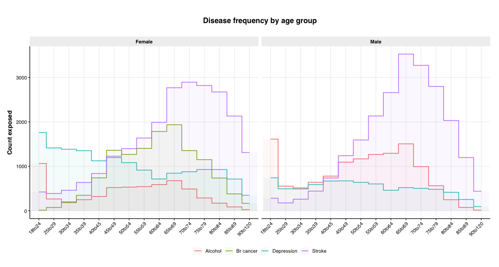{.r-stretch fig-align="center"}

## Disease population comparison – diagnosis year

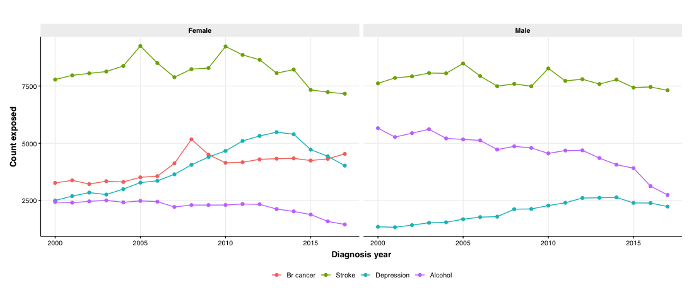{.r-stretch fig-align="center"}

::: notes
Olegeur doesn't see decline in recent years
Alcohol use disorder- more treatment outside of hospital

See time trends by age? follow up

Maybe oldest age differences drives time pattern?
:::

## Disease population comparison – labor status

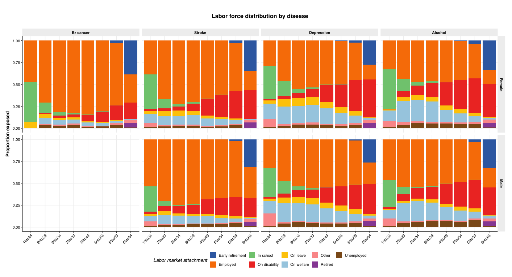{.r-stretch fig-align="center"}

## Table 1

-   Standard population characteristics table in health econ, epi papers
-   Describes general population, your sample, your comparison
-   Often grouped
-   Useful for exploration and explanation

------------------------------------------------------------------------

:::: columns
::: {.column width="50%"}
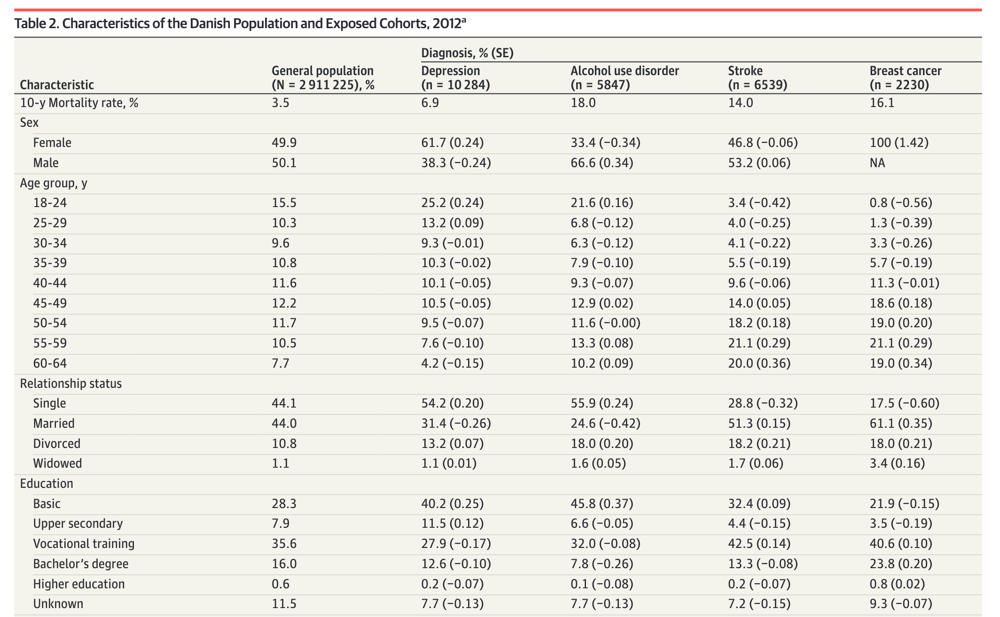
:::

::: {.column width="50%"}
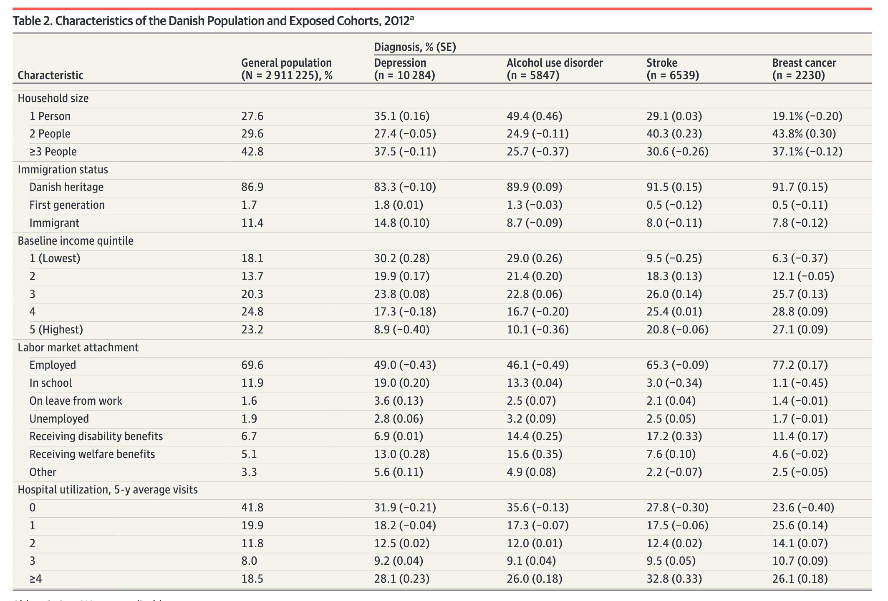
:::
::::

## Data visualization

-   Questions:
    -   What do the different disease populations look like?
    -   How do they differ?
    -   [What are the average outcomes of exposed, control groups?]{.c-red}
    -   [What are the impacts of disease?]{.c-red}
-   Presentation:
    -   Exploration vs. explanation

## Exploration – shiny app

## Income losses continue 10 years after diagnosis, not explained by disease risk

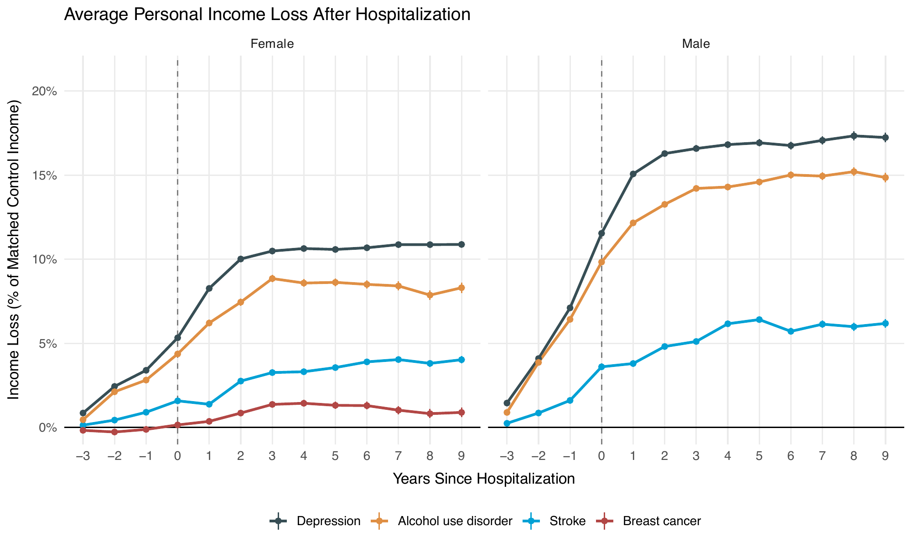{.r-stretch fig-align="center"}

## Prime working ages, young males with depression most impacted

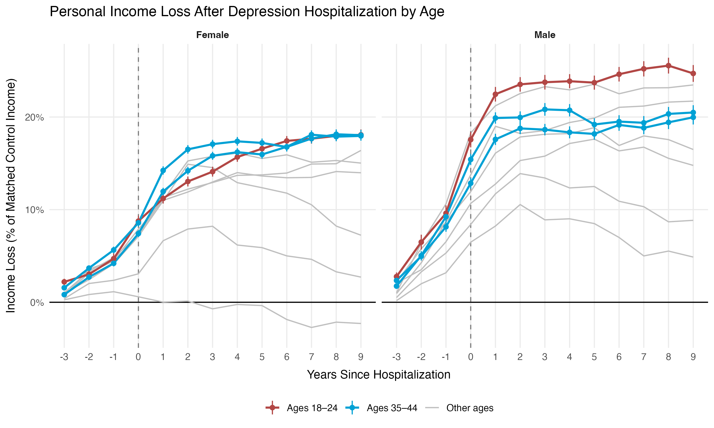{.r-stretch fig-align="center"}

## Differential loss patterns across disease and demographics

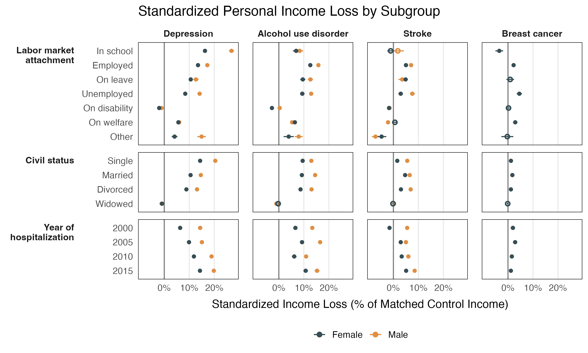{.r-stretch fig-align="center"}

::: notes
Fine balance - Bijan - could incldue more continuous variables
:::

## Disease diagnosis and 10y parenthood rates

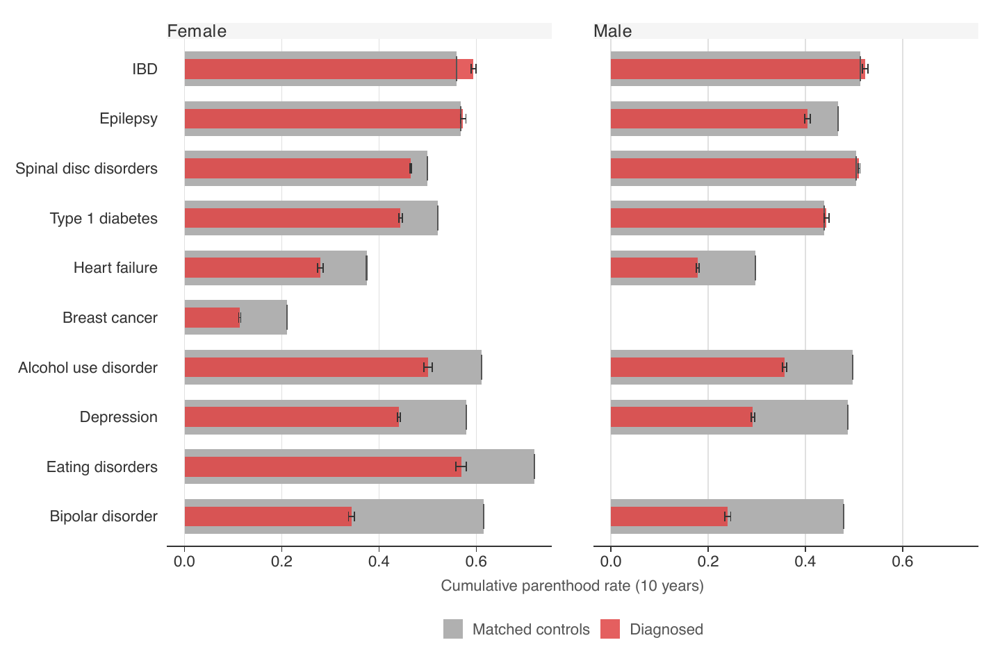{.r-stretch fig-align="center"}

## Widening parenthood gap with time for many diseases

::: {style="text-align: center; font-size: 0.6em;"}
Cumulative 10-year parenthood rates differences over time
:::

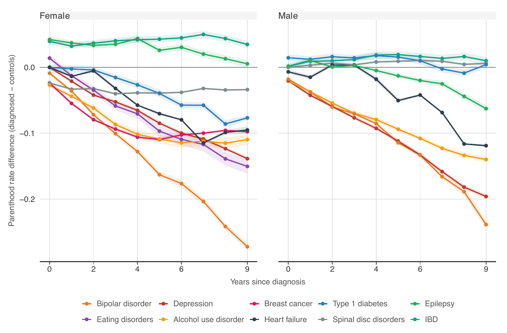{.r-stretch fig-align="center"}

::: notes
Mental disorders have strong impacts for both sexes

For females many physical disorders also have a significant impact – breast cancer, back pain

Most dx, the gap widens – this isn't just a delay in having kids, it's a lower likelihood of having them
:::

## Recap

-   ExpBoD project – large data management project
    -   Iterative
    -   Large datasets
-   Data interpretation
    -   Table 1
    -   Exploratory data visualization/analysis
    -   Explanatory visualization
